## Tech Stack

<picture>
  <source media="(prefers-color-scheme: dark)" srcset="https://skillicons.dev/icons?i=html,css,js,ts,angular,tailwind,nodejs,express,git,github,vscode,postman,npm,arduino,raspberrypi&theme=dark">
  <source media="(prefers-color-scheme: light)" srcset="https://skillicons.dev/icons?i=html,css,js,ts,angular,tailwind,nodejs,express,git,github,vscode,postman,npm,arduino,raspberrypi&theme=light">
  
</picture>

  

<picture>
  <source media="(prefers-color-scheme: dark)" srcset="./assets/banner-nombre-dark.svg">
  <source media="(prefers-color-scheme: light)" srcset="./assets/banner-nombre-light.svg">
  
</picture>

  

<picture>
  <source media="(prefers-color-scheme: dark)" srcset="./assets/banner-ola-dark.svg">
  <source media="(prefers-color-scheme: light)" srcset="./assets/banner-ola-light.svg">
  
</picture>

  

<picture>
  <source media="(prefers-color-scheme: dark)" srcset="./assets/banner-sonido-dark.svg">
  <source media="(prefers-color-scheme: light)" srcset="./assets/banner-sonido-light.svg">
  
</picture>

  

<picture>
  <source media="(prefers-color-scheme: dark)" srcset="./assets/banner-aleatorio-dark.svg">
  <source media="(prefers-color-scheme: light)" srcset="./assets/banner-aleatorio-light.svg">
  
</picture>

  

<picture>
  <source media="(prefers-color-scheme: dark)" srcset="./assets/banner-lluvia-dark.svg">
  <source media="(prefers-color-scheme: light)" srcset="./assets/banner-lluvia-light.svg">
  
</picture>

  

<picture>
  <source media="(prefers-color-scheme: dark)" srcset="./assets/banner-contribuciones-dark.svg">
  <source media="(prefers-color-scheme: light)" srcset="./assets/banner-contribuciones-light.svg">
  
</picture>
